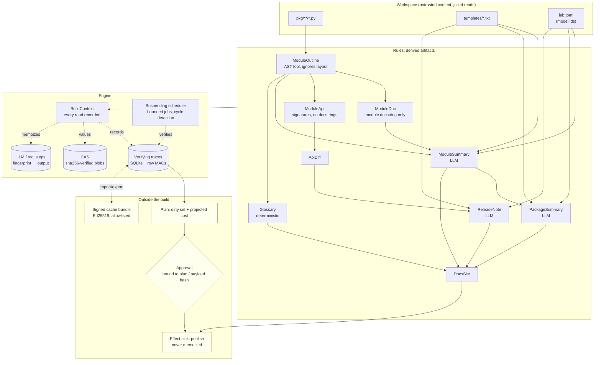

# incremental-agent-builds

A build system for LLM pipelines. Rules record what they actually read — files, other rules, tool
results, LLM outputs — and a rebuild re-runs only the steps a change can reach. When a re-run
produces the same value, propagation stops there. After every change the result is proven equal to a
build from an empty store.

## Problem

An agent that maintains derived artifacts over a changing corpus — per-module summaries, a
glossary, release notes — has two bad options.

Re-run everything on each change and pay for every LLM call again. On the reference workload in this
repo that is 83 calls and ~64k tokens per commit, for commits that usually change one docstring.

Or memoize. This is where it gets dangerous, because the cache key is almost always wrong in a way
that is invisible:

| The cache is keyed on | It misses |
|---|---|
| the artifact's explicit input (`@cache def summarize(source)`) | the prompt template, the model id, and the docstrings of imported modules that the prompt quotes |
| the SHA-256 of the rendered prompt | the model id, which is not prompt text |

Both then serve a stale artifact with no error and no warning. Measured over the 30-commit history
below: the input-hash cache serves 91 stale artifacts, the prompt-hash cache 2. This system serves 0,
and that is checked rather than asserted — after every commit the incremental store is compared
value-for-value against a clean rebuild.

The fix is not a better key. It is recording what each step read, at the granularity it read it.

## Architecture

A *rule* is an async function of a typed key. Every input it reads goes through its `BuildContext`,
which records what was read and the hash of what came back, in call order. Those records are the
rule's *verifying trace*.

```python
@rule(ModuleSummary)
async def module_summary(ctx: BuildContext, key: ModuleSummary) -> JsonValue:
    outline = await ctx.need(ModuleOutline(path=key.path))          # another rule
    docs = await ctx.need_all([ModuleDoc(path=p) for p in imports]) # discovered from a value
    model = await ctx.config("models.summary")                      # one config value, not the file
    result = await ctx.llm("module_summary", vars, model=model, schema=ModuleSummaryOut)
    return {"summary": result.summary, ...}
```

The set of keys this rule needs depends on `outline`, a value it computed a moment earlier. So the
dependency graph is not static and cannot be walked ahead of time — it is discovered as rules run,
which is what makes a suspending scheduler and runtime cycle detection necessary rather than
decorative.



**Rebuilding.** For a key with a trace, the scheduler walks the recorded dependencies *in the order
they were read*. A needed key is brought up to date first, then its current hash is compared with the
recorded one; a file, glob or config value is re-hashed; an LLM or tool step must still hold the
recorded output. The first mismatch stops the check and the rule re-runs. Order matters because the
dependencies are dynamic: a key that was needed after a value that has now changed may not be needed
at all this time, so it must not be built.

**Early cutoff.** When a rule does re-run and produces the same result hash as before, its dependents
see an unchanged hash and are not re-run. This is what makes a whitespace commit cost one rule
execution instead of a fan-out: `ModuleOutline` re-runs because the file changed, returns the same
value because the AST did not, and nothing downstream moves.

**LLM outputs are values.** A step's fingerprint covers the template text, the model id, `max_tokens`,
the system prompt, the output schema and the hash of every variable. Equal fingerprints mean
byte-identical requests, so reusing a recorded output is sound — and changing the model id or the
template invalidates it, which is exactly what the prompt-hash cache cannot do.

See [docs/SEMANTICS.md](docs/SEMANTICS.md) for the trace model, what a trace does and does not cover,
and the hermeticity contract the whole thing rests on.

## Quickstart

```bash
uv sync
uv run iab init                       # generate the 80-module reference workspace under var/
uv run iab build                      # cold build: every rule runs
uv run iab build                      # no-op: nothing runs
uv run iab plan                       # dirty set and projected cost, no rule executed
uv run iab explain module_summary:pkg/core/engine.py   # why that key would re-run
uv run python tasks.py demo           # the end-to-end story, offline, ~40s
```

No API key is needed anywhere above: `FakeProvider` answers as a pure function of the request, so the
pipeline is fully reproducible offline. With `ANTHROPIC_API_KEY` set, the same commands use the real
Anthropic API through the same provider interface.

The HTTP service exposes the same operations behind three scopes (`build:run`, `build:approve`,
`cache:import`):

```bash
export APP_JWT_SECRET=$(python -c "import secrets;print(secrets.token_urlsafe(32))")
uv run iab serve &
curl -sH "Authorization: Bearer $(uv run iab token --subject me --scope build:run)" \
     -X POST localhost:8000/v1/plan -d '{}' -H 'Content-Type: application/json'
```

`uv run python tasks.py check` runs lint, mypy --strict, the tests with coverage, bandit, pip-audit
and the baseline check. `tasks.py` and the `Makefile` are equivalent; `tasks.py` also runs on Windows.

## Results

All numbers below come from the benchmark scripts in `bench/`, run on the machine named in each
table. Nothing here is estimated. One snapshot per bench script is committed under
`bench/results/`, with the machine that produced it; `uv run python tasks.py bench` regenerates them and
CI uploads them as the `bench-results` and `savings-replay` artifacts.

**Reference workload.** A generated 80-module Python package (four derived rules per module, three of
them LLM-backed) plus a scripted 30-commit history covering whitespace-only edits, comment edits,
function- and module-docstring edits, signature changes, added and removed functions and methods, a
module rename, two new modules, two prompt-template edits and two model-id changes.

### Savings over the 30-commit replay

`uv run python bench/bench_savings.py --commits 30` — Windows 10, Intel i7-8750H (6 cores), Python
3.12.14, 4 jobs. Cold build: 287 rules, 81 LLM calls, 61,692 tokens, 2.0 s.

| Metric | This system | Clean rebuild every commit | Saved |
|---|---:|---:|---:|
| LLM calls, 30 commits | 181 | 2,488 | **92.7%** |
| Tokens, 30 commits | 215,857 | 1,929,747 | **88.8%** |
| Median per-commit calls saved | | | **97.6%** |
| Median per-commit tokens saved | | | **91.2%** |

The spec target was ≥80% median savings. Per commit kind:

| Commit kind | Rules executed | Early cutoffs | LLM calls | Clean rebuild | Saved |
|---|---:|---:|---:|---:|---:|
| whitespace-only | 1 | 1 | 0 | 81–84 | 100% |
| comment-only | 1 | 1 | 0 | 82–83 | 100% |
| function docstring | 6–7 | 1–2 | 2 | 81–84 | 98% |
| module docstring (widely imported) | 11–25 | 2 | 6–20 | 81–84 | 75–93% |
| signature change | 9–10 | 1–2 | 3 | 82–84 | 96% |
| module rename | 96 | 81 | 5 | 83 | 94% |
| new module | 90–91 | 80–81 | 3 | 83–84 | 96% |
| model id change | 2 | 0 | 1 | 83 | 99% |
| prompt template edit | 2–83 | 0 | 1–82 | 83 | 1–99% |

The template edit is the honest worst case: editing the `module_summary` template invalidates every
module summary, so the first such commit re-runs 82 of 83 LLM calls. That is correct — every summary
really is a function of that template — and it is exactly what the input-hash cache silently gets
wrong. The second template commit edits `release_note`, which one artifact depends on, so it costs 1
call.

### Correctness, measured not asserted

| Check | Result |
|---|---|
| Commits after which the store equals a clean rebuild, value for value | **30 / 30 (100%)** |
| Rules executed with no changed direct dependency (oracle from two clean builds) | **0** |
| Stale artifacts served by this system | **0** |
| Stale artifacts served by an input-hash cache baseline | 91 (70 still stale after 30 commits) |
| Stale artifacts served by a prompt-hash cache baseline | 2 (both on model-id commits) |
| Random rule programs × edit sequences equal to a clean rebuild (hypothesis, soak profile) | **1,000 / 1,000** |

### Ablations

Both mechanisms are load-bearing, and they save different things:

| Configuration | Rules executed | LLM calls |
|---|---:|---:|
| Full system | 544 | 181 |
| No early cutoff | 667 (1.23×; up to **14×** on a single commit) | 181 |
| No early cutoff, no step memoization | 667 | 479 (**2.65×**) |

Early cutoff saves rule *executions*; step memoization saves LLM *calls*. The aggregate cutoff ratio
is diluted because most commits touch little — the per-commit maximum is where the mechanism bites.

### Detection rates

`uv run python bench/bench_robustness.py` — 200 samples each, same machine.

| Attack | Detected |
|---|---|
| Flipped byte in a CAS blob (random position and bit) | **200 / 200 (100%)** |
| Edited trace row in SQLite (6 columns, cycled) | **200 / 200 (100%)** |
| Poisoned cache entry: unsigned, forged body, foreign signer, re-signed claim, blob mismatch | **200 / 200 (100%)**, 0 accepted |
| Injected dependency cycle (lengths 1–7, 1–4 jobs) | **60 / 60 (100%)** raised `CycleError` |

### Hot paths

`uv run python bench/bench_baseline.py` — same machine.

The last column is the p95 spread over three consecutive runs, because the rows that touch the disk
move with whatever else the machine is doing. The p50/p95 columns are one run — the one in
`bench/results/baseline.json`.

| Benchmark | p50 | p95 | p95 over 3 runs |
|---|---:|---:|---:|
| **No-op rebuild, 1,000 rules** | 275 ms | **283 ms** | 273–284 ms |
| Cold build, 1,000 rules | 456 ms | 482 ms | 417–482 ms |
| Plan (dirty set + cost), 1,000 rules | 85.7 ms | 108 ms | 90.8–115 ms |
| Load + authenticate 1,000 trace rows | 36.8 ms | 48.7 ms | 44.8–48.7 ms |
| LLM step fingerprint | 18.4 µs | 22.3 µs | 20.6–27.8 µs |
| CAS verified read, 4 KB | 218 µs | 349 µs | 273–349 µs |
| Audit append, batched (200 entries, one fsync + one anchor write) | 25.1 ms | 27.0 ms | 27.0–28.2 ms |
| Audit chain verify, 1,000 entries | 36.2 ms | 39.1 ms | 39.1–49.7 ms |

The no-op rebuild target from the spec was <500 ms for 1,000 rules; measured 283 ms p95, 273–284 ms
over three runs. The four disk-touching rows (both builds, the trace-store load and the two audit
rows) are load-sensitive: they move by tens of percent when the machine is busy, and a number taken
while the test suite is running is not comparable to one taken on an idle laptop. That is why CI
enforces 1,200 ms for the no-op rebuild rather than the measured value — the thresholds are
order-of-magnitude regression guards, not the claim. Every threshold and where it came from is in
`bench/thresholds.json`; [CLAIMS.md](CLAIMS.md) maps each statement above to the test, bench or CI job
that backs it.

Loading and authenticating the trace rows is about a sixth of the no-op rebuild, and it is the floor:
every build pays it before it can decide that there is nothing to do.

## Security

Source files are untrusted input. The design assumption is that a file in the workspace may be
written by someone hostile, and that the model may be talked into anything.

- **Prompt injection has nothing to drive.** Source text reaches the model only inside an
  `<untrusted-data>` envelope whose escaping cannot be closed from inside, and **the model is offered
  no tools at all** — rules call tools, models never do. Every output is validated against a strict
  schema before it becomes a value. The tests use a deliberately gullible fake model that obeys any
  injected instruction, and show that the containment does not depend on the model's judgement.
- **Least privilege by construction.** The build tool registry refuses to register a tool that
  declares any side-effecting capability, so a build step *cannot* have an effect. Effects are
  separate, never memoized, and run only after a successful build.
- **Approvals bound to hashes.** Executing a costly plan needs an approval bound to the plan hash —
  which covers the targets, the dirty set, the projected cost *and* the hashes of the inputs the
  approver saw. Publishing needs one bound to the payload hash. Approvals are single-use, expire, and
  cannot be granted by the principal that requested them.
- **Budgets.** Per-build step, token and USD limits are enforced during execution, and a build that
  was approved from a plan runs under a budget derived from that plan's estimate.
- **Verified storage.** The CAS re-hashes every read; a value that fails is recomputed and must hash
  to the same thing. Every trace and step row carries an HMAC over its exact stored text, so an
  edited row is treated as absent rather than trusted.
- **Signed sharing.** Shared-cache entries are Ed25519-signed and only accepted from an allowlisted
  key. The signature is re-checked when an entry is *used* — for imported traces *and* for the LLM
  outputs and tool results that travelled with them — so removing a key revokes retroactively
  everything it signed. A store never re-exports, or re-signs, anything it merely imported.
- **Jailed reads and a contained parser.** Paths are validated and resolved with `realpath`; a symlink
  out of the workspace is refused and invisible to globs. Untrusted Python is parsed in a separate
  `python -I` process with a timeout and an output cap.
- **Hermeticity guard.** In test mode a `sys.addaudithook` hook fails any rule that reads something
  outside its `BuildContext`, because such a read would not be in the trace. It is a guard against
  honest mistakes, not a sandbox — [docs/adr/0004](docs/adr/0004-hermeticity-guard-not-sandbox.md)
  says what it cannot see.
- **Hash-chained audit.** Executions, cache hits, imports, approvals and effects are appended to a
  hash-chained log with a `verify` command. Dropping the tail of a hash chain leaves a valid shorter
  chain, so the head is recorded in a sidecar file on every append and checked by default — both by
  `iab audit verify` and by reopening the log. An operator who keeps a copy of the head somewhere the
  writer cannot reach passes it as `--expect-head`; that is the only version of this control that
  survives an attacker with write access to both files.
- **Scoped API.** `build:run`, `build:approve` and `cache:import` are separate; HS256 tokens are
  verified with a pinned algorithm and required `exp`/`iat`/`nbf`/`iss`/`aud`/`sub`, and the routes
  fail closed (503) when no secret is configured. Rate-limit buckets are per token subject, then per
  API key, then per client address (/64 for IPv6): the limiter verifies the bearer token itself,
  because route dependencies run after ASGI middleware and the routes that spend money are the ones
  behind a token.

Reuse is observable rather than only benchmarkable: `/metrics` separates rules executed (by rule),
reused and cut off, tokens not spent again, and cache-import rejections by reason, and each rule gets
a span carrying its outcome, the reason it ran and its dependency counts per kind.

[docs/THREAT_MODEL.md](docs/THREAT_MODEL.md) has the STRIDE table with a test for every control.
[SECURITY.md](SECURITY.md) has reporting.

## Non-goals

- **Not a sandbox.** The workspace jail and the hermeticity guard contain well-behaved rule code
  reading untrusted *content*. They do not contain hostile rule code, and they are not a defence
  against a concurrently malicious local user. Use OS-level isolation for that.
- **No cross-process concurrent builds on one store.** Builds on one engine are serialized. Two
  processes sharing a store directory is not supported; the shared cache is the supported way to move
  results between stores.
- **No distributed execution.** The scheduler bounds concurrency within one process. Remote workers
  are out of scope; the signed cache bundle covers the "someone else already computed this" case.
- **No prompt caching or batch requests.** Anthropic prompt caching and the Batches API are not wired
  in. They would cut the cost of the calls that *do* happen and are orthogonal to the dependency
  tracking this repo is about. (The provider does stream responses above 16K `max_tokens`, because a
  non-streaming request that large risks an SDK timeout that a retry would re-bill.)
- **Rule *code* is not hashed.** A trace records the rule's declared `version`, not a hash of its
  source. Changing what a rule computes without bumping its version leaves stale values behind — see
  [docs/adr/0002](docs/adr/0002-verifying-traces-over-dirty-bits.md) for why, and
  docs/SEMANTICS.md for the contract.
- **The LLM is treated as deterministic per request.** That is exact for `FakeProvider` and an
  assumption for a real model: the engine stores the first answer and reuses it. It never re-asks to
  check, and it is not a consistency framework for non-deterministic tools. There is no n-sample
  agreement study and no re-ask-a-fraction-of-reused-steps mode that would bound how much that
  assumption costs; `docs/SEMANTICS.md` states the assumption, and nothing here measures it.
- **Budgets are checked before a call and charged after it.** The token and USD limits can therefore be
  crossed by every call already past its reservation — up to `jobs` of them — and a call the resulting
  abort cancels is billed by the provider without reaching the ledger. The step limit is the only one
  enforced strictly before spending.
- **Volatile tools are implemented but not exercised by the measured workload.** TTL expiry, refresh
  and cutoff-on-unchanged are unit-tested; the 80-module reference workload registers only the
  deterministic `ast_outline` tool, so no number in the table above depends on a volatile step.
- **Not a general-purpose build tool.** There is no file-output model, no sandboxed command execution
  and no remote cache protocol. It builds JSON values from tracked inputs.
- **No UI.** A CLI and a JSON HTTP API; the "docs site" the demo publishes is a directory of Markdown.

## Repository layout

| Path | What is in it |
|---|---|
| `src/incremental_agent_builds/engine/` | keys, rules, `BuildContext`, scheduler, traces, CAS, planner, effects, shared cache, hermeticity guard |
| `src/incremental_agent_builds/workload/` | the generated package, the commit history, the rules, the naive baselines, the replay harness, the demo |
| `src/incremental_agent_builds/api/` | `BuildService`, scoped routes, JWT verification |
| `src/incremental_agent_builds/agentic/` | provider protocol (Fake / Replay / Anthropic), envelopes, approvals, budgets, audit log |
| `src/incremental_agent_builds/core/` | settings, redacting logs, tracing, metrics, hardened FastAPI app |
| `tests/property/` | clean equivalence, minimality, cycles, tamper resistance |
| `bench/` | the three benchmark scripts and their thresholds |
| `docs/` | SEMANTICS, THREAT_MODEL, ADRs |

## License

MIT. See [LICENSE](LICENSE).
