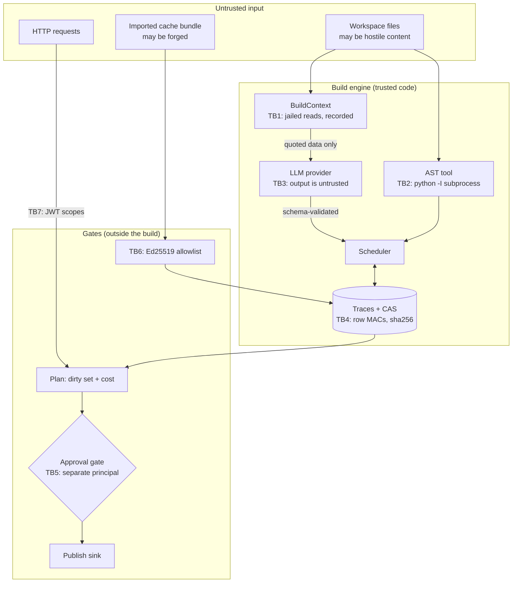

# Threat model

Method: STRIDE per trust boundary. Each row names a threat, the control that addresses it, and the
test, bench script or CI job that proves the control works. `scripts/check_baseline.py` verifies that
every backticked evidence reference resolves to a real test function, file or CI job.

## What this system is

A build engine that derives documentation artifacts from a workspace of source files by calling an
LLM and read-only tools, reusing recorded results when nothing they depend on has changed, and sharing
those results between stores.

## Assets

| Asset | Why it matters |
|---|---|
| **The integrity of derived values** | A stale or forged value propagates into every artifact built from it and into whatever the publish step writes out. This is the asset the whole repo exists to protect. |
| Spend (LLM tokens and USD) | The reason for caching at all; also the reason an attacker who can invalidate everything can cost money. |
| The trace store and CAS | Wrong contents mean wrong values or wasted work. |
| Shared-cache signing keys and the trust allowlist | A key that should not be trusted lets an attacker choose values directly. |
| Audit evidence | What happened, what was approved, what was reused. |
| Provider credentials, and personal data in prompts and logs | Standard. |

## Trust boundaries

- **TB1** A rule reads only through `BuildContext`, which validates and jails paths and records every
  read. File *content* is hostile; the path set is controlled.
- **TB2** Untrusted Python is parsed in a separate isolated interpreter that receives source text,
  never a path.
- **TB3** Model output is untrusted data: it is schema-validated before becoming a value, and the model
  is offered no tools.
- **TB4** Stored rows and blobs are authenticated; a store is treated as possibly corrupted.
- **TB5** Approvals come from a principal that is not the requester.
- **TB6** Foreign cache entries are only accepted from allowlisted signers, and re-checked at use.
- **TB7** HTTP callers present a scoped bearer token.

## Assumptions

TLS terminates in front of the service. The host, the Python interpreter and the container runtime are
trusted. Rule code is written by the repo's authors and is honest (see ADR 0004 — the hermeticity guard
is not a sandbox). Principal strings reach the approval store from authenticated identities, never from
model output. The trace store directory and the approval file are as protected as the audit log: an
attacker with write access to them is assumed to be able to forge their contents, which is why every
stored value is re-verified against current inputs rather than trusted.

## STRIDE table

| ID | STRIDE | Threat | Entry point / asset | Control | Test / evidence | Residual risk |
|---|---|---|---|---|---|---|
| **B1** | Tampering | **A stale value is served after a hidden dependency changes** (the template, the model id, a quoted file) — the core failure of prompt-hash and input-hash caches | Derived values | Every input goes through `BuildContext` and enters the trace with its hash; the LLM step fingerprint covers template text, model id, `max_tokens`, system prompt, schema and every variable; config values are tracked per key | `tests/property/test_incremental_semantics.py::test_incremental_build_equals_a_clean_rebuild_after_every_edit`, `tests/unit/test_llm_step.py::test_every_part_of_the_request_changes_the_fingerprint`, `tests/unit/test_naive_baseline.py::test_neither_baseline_sees_a_model_id_change`, `bench/bench_savings.py` | Rule *code* is not hashed, only its declared `version`; forgetting to bump it leaves stale values (ADR 0002, README non-goals) |
| **B2** | Tampering | A rule reads an input outside `BuildContext`, so the value is not a function of its trace | Derived values | `sys.addaudithook` guard marks rule bodies; audited I/O outside a `BuildContext` permit is a violation — fatal in `strict` (used by the property tests), counted in `warn`; semgrep flags clock/RNG/env reads the hook cannot see | `tests/unit/test_hermeticity.py::test_strict_mode_fails_the_rule_that_read_behind_the_engines_back`, `tests/unit/test_hermeticity.py::test_warn_mode_records_the_violation_and_completes_the_build`, `.github/workflows/ci.yml#semgrep` | Cannot see clock, RNG, pre-opened handles or native extensions; not a sandbox (ADR 0004) |
| **B3** | Tampering | A build re-runs a rule whose dependencies did not change, or skips one whose did | Spend, correctness | Recorded dependencies are walked in order with early exit; minimality is checked against an oracle computed from two clean builds | `tests/property/test_incremental_semantics.py::test_incremental_build_equals_a_clean_rebuild_after_every_edit`, `tests/unit/test_scheduler.py::test_a_key_no_longer_needed_is_not_rebuilt`, `tests/unit/test_oracle_and_budgets.py::test_a_rerun_with_no_changed_dependency_is_reported` | The oracle judges direct dependencies; it cannot detect a rule that reads too much through `ctx` and is therefore *correctly* invalidated too often |
| **B4** | Tampering | A bumped tool version leaves keys reusing results from the old tool | Derived values | Verifying a tool dependency re-checks that the registered tool still has the recorded version; an unregistered tool counts as changed | `tests/unit/test_build_tools.py::test_a_tool_version_bump_invalidates_its_memoized_results` | Same `version`, changed behaviour is undetected, as for rules |
| **T1** | Tampering | A CAS blob is flipped, truncated, extended or swapped for another | Derived values | SHA-256 recomputed on every read; only lowercase-hex names accepted, so a digest can never become a path; a value that fails is recomputed and must hash the same, else the build raises | `tests/property/test_tamper.py::test_any_flipped_byte_in_a_blob_is_detected`, `tests/property/test_tamper.py::test_a_blob_swapped_for_another_is_detected`, `tests/unit/test_cas.py::test_non_canonical_json_is_refused_even_when_the_hash_matches`, `bench/bench_robustness.py` | An attacker who can write blobs can delete them (denial of service, not a wrong value) |
| **T2** | Tampering | A trace or step row in SQLite is edited, or a valid row is copied onto another key | Derived values | HMAC-SHA256 over each row's exact stored text, keyed per store; a row that fails is reported and treated as absent, so the key recomputes | `tests/property/test_tamper.py::test_editing_any_trace_column_fails_the_mac`, `tests/property/test_tamper.py::test_a_trace_row_copied_to_another_key_fails_the_mac`, `tests/property/test_tamper.py::test_editing_a_step_row_fails_the_mac`, `bench/bench_robustness.py` | The MAC key sits next to the database; an attacker with both can forge rows. A rollback to an older correctly-MAC'd state only causes extra work, never a stale value, because traces are always re-verified |
| **T3** | Tampering | **A forged shared-cache entry injects a chosen value** | Derived values, TB6 | Ed25519 signature over a domain-separated canonical body, from an allowlisted signer; the named blob must be present, hash to the claimed result and be canonical JSON; the entry is then only a candidate — its dependencies are verified locally and the signature re-checked at use | `tests/property/test_tamper.py::test_editing_a_signed_cache_entry_breaks_its_signature`, `tests/property/test_tamper.py::test_unsigned_and_untrusted_entries_are_rejected`, `tests/unit/test_shared_cache.py::test_an_imported_entry_is_not_used_when_a_dependency_differs`, `tests/unit/test_shared_cache.py::test_revoking_a_signer_stops_its_entries_being_used`, `bench/bench_robustness.py` | A trusted signer's compromised key can inject values until it is removed from the allowlist; there is no key server or revocation list (ADR 0005) |
| **T4** | Tampering | Trust launders itself: a store re-signs results it imported from elsewhere | TB6 | Only traces with `origin == "executed"` are exported; volatile tool steps are never exported | `tests/unit/test_shared_cache.py::test_only_locally_executed_traces_are_re_exported`, `tests/unit/test_shared_cache.py::test_a_volatile_tool_step_is_never_exported` | None known |
| **T5** | Tampering | Audit entries edited, deleted, reordered or truncated; concurrent writers fork the chain | Audit log | Hash chain over canonical JSON; `iab audit verify` with an optional head anchor; a broken chain refuses to open; each append takes a file lock, adopts other writers' verified entries and refuses a file that shrank or was rewritten | `tests/unit/test_audit.py::test_any_single_byte_change_is_detected`, `tests/unit/test_audit.py::test_tail_truncation_needs_an_anchored_head`, `tests/unit/test_audit.py::test_two_writers_on_one_file_extend_a_single_chain`, `tests/integration/test_cli.py::test_a_tampered_audit_log_fails_verification` | Write access allows rebuilding the whole chain; anchor the head elsewhere |
| **T6** | Tampering | Arguments change between approval and execution (a costlier plan, a different payload) | TB5 | Approval bound to the canonical hash of the call; the plan hash covers targets, dirty set, projected cost *and* the hashes of the inputs the approver saw; the publish hash covers every page byte; single use; expiry | `tests/unit/test_effects.py::test_an_approval_for_one_payload_does_not_release_another`, `tests/unit/test_effects.py::test_an_approval_for_one_plan_does_not_authorize_a_different_one`, `tests/unit/test_plan.py::test_the_plan_hash_changes_with_anything_an_approver_saw`, `tests/unit/test_approval.py::test_an_approval_does_not_transfer_to_changed_arguments` | The approval file is not signed: whoever can write it can forge an approved record |
| **T7** | Tampering | Budget ledger edited to reset spend, or several workers each spend the full budget | Spend | Limits cannot be raised on resume; ledgers sharing a file lock and reload, counters never move backwards, tightest limits win | `tests/unit/test_budget.py::test_state_survives_restart_and_limits_cannot_be_raised`, `tests/unit/test_budget.py::test_ledgers_sharing_a_file_cannot_double_spend`, `tests/unit/test_oracle_and_budgets.py::test_a_ledger_refuses_to_raise_limits_on_resume` | A reset while no ledger is open goes unnoticed; reconcile against the audit log |
| **T8** | Tampering | Compromised dependency, base image or CI action | Build pipeline | `uv.lock` with hashes; pip-audit; base images pinned by digest; trivy scan; CycloneDX SBOM; Dependabot | `.github/workflows/ci.yml#audit`, `.github/workflows/ci.yml#docker` | Actions are tag-pinned until SHA pinning at publish time |
| **S1** | Spoofing | Caller forges or replays a bearer token, or uses one minted for another service | TB7 | HS256 with a pinned algorithm (`alg: none` and algorithm substitution refused); `exp`, `iat`, `nbf`, `iss`, `aud`, `sub` all required; token lifetime capped; secret must be ≥32 bytes; uniform opaque 401; routes fail closed (503) with no secret configured | `tests/unit/test_api_auth.py::test_an_unsigned_alg_none_token_is_refused`, `tests/unit/test_api_auth.py::test_every_required_claim_is_required`, `tests/unit/test_api_auth.py::test_a_token_whose_lifetime_exceeds_the_limit_is_refused`, `tests/integration/test_api.py::test_the_routes_fail_closed_without_a_configured_secret` | One shared secret, no rotation or revocation list; a leaked token is valid until it expires |
| **S2** | Spoofing | Caller guesses, replays or brute-forces the API key used for `/metrics` | TB7 | Keys stored as SHA-256 digests; constant-time compare against every digest with no early exit; fail closed with no keys | `tests/unit/test_security.py::test_every_configured_digest_is_compared_without_early_exit`, `tests/unit/test_security.py::test_no_configured_keys_fails_closed` | No expiry or rotation workflow |
| **S3** | Spoofing | A principal approves its own plan or publish | TB5 | The approval store refuses a decision from the requester, and an approval can be consumed only by the principal that requested it | `tests/unit/test_effects.py::test_a_requester_cannot_approve_its_own_plan`, `tests/unit/test_effects.py::test_an_approval_does_not_transfer_to_another_principal`, `tests/integration/test_api.py::test_a_requester_cannot_approve_its_own_plan_over_http` | Holding both scopes is still allowed; the split is enforced per request, not per identity |
| **S4** | Spoofing | Source content forges an `<untrusted-data>` envelope claiming a trusted source | TB3, prompts | Reversible escaping so the body cannot open or close an envelope; envelope id is a hash of source and content | `tests/unit/test_llm_step.py::test_source_text_cannot_close_or_forge_an_envelope`, `tests/unit/test_envelope.py::test_a_forged_envelope_inside_content_is_neutralized` | Envelopes help the model tell data from instructions; they do not bind it (see E1) |
| **E1** | Elevation of privilege | **Prompt injection in a source file makes the model take an action** | TB3 | Structural, not behavioural: the model is offered **no tools at all** — rules call tools, models never do — and its output must validate against a strict schema before becoming a value. Tested with a deliberately gullible model that obeys any injected instruction | `tests/unit/test_llm_step.py::test_a_request_offers_the_model_no_tools`, `tests/unit/test_naive_baseline.py::test_a_gullible_model_returns_injected_json_verbatim`, `tests/unit/test_llm_step.py::test_source_text_cannot_close_or_forge_an_envelope` | Injected text can still influence the *content* of a summary within the schema. Generated docs are not trustworthy prose; they are derived data |
| **E2** | Elevation of privilege | A build step performs a side effect | Derived values, external systems | The build tool registry refuses to register a tool declaring any capability other than read-only, so a build step structurally cannot have an effect; effects are separate sinks, never memoized, and run only after a successful build behind an approval | `tests/unit/test_build_tools.py::test_a_tool_with_any_side_effecting_capability_is_refused`, `tests/unit/test_effects.py::test_publishing_after_a_failed_build_is_refused`, `tests/unit/test_effects.py::test_publishing_is_refused_until_approved_and_then_applies` | A tool handler could still do I/O its declared capability does not cover; handlers are repo code and reviewed |
| **E3** | Elevation of privilege | A rule reads or writes outside the workspace (`..`, absolute path, symlink) | TB1 | Paths validated (no absolute, drive, backslash, NUL, `.`, `..`) and resolved with `realpath`; anything outside the resolved root is refused; the opened file's identity is re-checked; a symlink out of the jail is invisible to globs; size cap | `tests/unit/test_workspace.py::test_unsafe_paths_are_refused`, `tests/unit/test_workspace.py::test_a_symlink_out_of_the_jail_is_refused_and_invisible`, `tests/unit/test_workspace.py::test_a_file_larger_than_the_cap_is_refused` | A jail for well-behaved rule code reading hostile content, not against a concurrently malicious local user (README non-goals) |
| **E4** | Elevation of privilege | Hostile Python source exhausts the stack or memory, or escapes, while being parsed | TB2 | `ast.parse` runs in a separate `python -I` interpreter that receives source text and never a path; per-request timeout, output cap, and replacement of a dead worker | `tests/unit/test_ast_tool.py::test_a_worker_that_never_answers_is_killed_and_reported`, `tests/unit/test_ast_tool.py::test_a_worker_that_floods_stdout_is_cut_off_at_the_cap`, `tests/unit/test_ast_tool.py::test_a_reply_for_another_request_id_is_refused` | The child is an ordinary process, not a sandbox: it shares the filesystem and network namespace |
| **E5** | Elevation of privilege | Deserialization of an artifact runs code | Store, bundles | No pickle-family serialization anywhere; bundles are JSON validated by closed pydantic models; blobs must be canonical JSON | `tests/unit/test_no_pickle.py::test_source_tree_has_no_pickle_family_serialization`, `tests/unit/test_cas.py::test_invalid_utf8_and_broken_json_are_refused`, `.github/workflows/ci.yml#semgrep` | Third-party libraries may deserialize unsafely on their own paths |
| **E6** | Elevation of privilege | Code execution inside the container escalates | Runtime | Non-root UID 10001; read-only root filesystem; all capabilities dropped; `no-new-privileges` | `.github/workflows/ci.yml#docker` | Kernel or runtime vulnerabilities |
| **E7** | Elevation of privilege | After a server-side refusal fallback, a tool call from the declined attempt is executed or echoed | TB3, AnthropicProvider | Blocks other than text before the last `fallback` marker are dropped; executed calls and echoed content must agree | `tests/unit/test_anthropic_provider.py::test_blocks_of_a_declined_attempt_before_the_fallback_marker_are_dropped`, `tests/unit/test_providers.py::test_response_content_must_agree_with_tool_calls` | Verified against a mocked client only |
| **D1** | Denial of service | A dependency cycle deadlocks the build | Availability | A waits-for graph over suspended keys is checked before each suspension; a self-dependency is caught immediately; keys outside the cycle still build | `tests/property/test_cycles.py::test_every_injected_cycle_raises_cycle_error`, `tests/property/test_cycles.py::test_keys_outside_the_cycle_still_build`, `bench/bench_robustness.py` | The check is exact reachability, so its cost grows with the number of simultaneously suspended keys |
| **D2** | Denial of service | A runaway or manipulated build burns tokens and money | Spend | Per-build step, token and USD budgets enforced during execution; a plan-approved build runs under a budget derived from that plan's estimate; an exhausted budget aborts but keeps finished traces so a retry resumes | `tests/unit/test_oracle_and_budgets.py::test_a_step_budget_aborts_the_build_and_keeps_finished_traces`, `tests/unit/test_oracle_and_budgets.py::test_a_token_budget_stops_further_steps`, `tests/unit/test_plan.py::test_an_estimated_plan_gets_a_budget_bounded_by_its_estimate` | One call can overshoot a token or USD limit, because usage is only known afterwards |
| **D3** | Denial of service | An expensive build is triggered without review | Spend | A plan projected above the configured threshold needs an approval bound to it; optionally an unpriceable plan does too | `tests/integration/test_api.py::test_a_costly_plan_needs_an_approval_before_it_runs`, `tests/integration/test_api.py::test_a_plan_that_cannot_be_priced_needs_an_approval` | The plan is an upper bound on dirty keys but cannot see early cutoff, so it over-estimates |
| **D4** | Denial of service | Request floods, oversized bodies, oversized cache bundles | TB7 | Token bucket per verified key or client address, probes exempt; Content-Length and streaming byte limits; bundle size capped before parsing; every request list bounded by validation | `tests/integration/test_app.py::test_rate_limit_rejects_bursts_and_exempts_probes`, `tests/integration/test_api.py::test_an_oversized_body_is_refused`, `tests/unit/test_shared_cache.py::test_an_oversized_bundle_is_refused_before_parsing`, `tests/integration/test_api.py::test_too_many_targets_are_refused_by_validation` | In-process rate limiting only; behind a proxy all clients share one address unless proxy headers are trusted |
| **D5** | Denial of service | Crafted text makes redaction backtrack quadratically | Logs | Patterns anchored with lookbehinds and bounded quantifiers | `tests/unit/test_redaction.py::test_redaction_stays_fast_on_adversarial_input`, `bench/bench_baseline.py` | Other regex-heavy code needs the same review |
| **D6** | Denial of service | Container exhausts host resources | Runtime | Compose memory, CPU and PID limits | `.github/workflows/ci.yml#docker` | Limits are deployment-specific |
| **I1** | Information disclosure | PII or secrets in prompts, logs, traces or audit records | Prompts, logs | Variable content is redacted before rendering into a prompt (and the redaction flag is part of the step fingerprint, so it cannot change silently); structlog and stdlib records pass a redacting processor; audit data is redacted before hashing | `tests/unit/test_llm_step.py::test_redaction_applies_to_variable_content`, `tests/unit/test_logging.py::test_exception_tracebacks_are_redacted`, `tests/unit/test_audit.py::test_entries_are_redacted_before_hashing` | Pattern-based: names, addresses and free-form identifiers are not detected |
| **I2** | Information disclosure | Error bodies leak workspace content, paths or internals | TB7 | Fixed error codes and messages; engine errors become a generic 400 with the type logged, not returned; validation details without input; readiness reports names only | `tests/integration/test_app.py::test_unhandled_exceptions_become_generic_500s`, `tests/integration/test_app.py::test_validation_errors_never_echo_submitted_values`, `tests/integration/test_api.py::test_an_unknown_target_is_a_client_error` | None known |
| **I3** | Information disclosure | A cache bundle carries prompts or source content to another party | TB6 | Bundles contain hashes, step metadata and result blobs — never prompts or source text; cassettes likewise store request hashes, not bodies | `tests/unit/test_shared_cache.py::test_an_exported_bundle_carries_traces_steps_and_their_blobs` | Result blobs *are* derived from source content by design; do not share bundles across a trust boundary you would not share the docs with |
| **I4** | Information disclosure | Metrics expose raw paths or ids, or are world-readable | `/metrics` | Route-template labels; an API key required by default | `tests/integration/test_app.py::test_metrics_require_auth_and_label_route_templates`, `tests/integration/test_api.py::test_metrics_require_a_key_and_report_the_build_counters` | Operators may disable auth for scraping; restrict by network then |
| **I5** | Information disclosure | Secrets committed to the repository | Git history | Only `.env.example` is committed and its secret values must be empty; `.env` ignored; gitleaks and the semgrep secrets pack in CI | `tests/unit/test_config.py::test_env_example_documents_every_setting`, `.github/workflows/ci.yml#secrets` | Scanners miss unusual secret formats |
| **I6** | Information disclosure | Cross-origin pages read API responses | Browsers | Explicit origin list, no credentials, `*` refused by config validation; strict security headers | `tests/integration/test_app.py::test_cors_allows_only_configured_origins`, `tests/unit/test_config.py::test_wildcard_or_malformed_origins_are_rejected` | None known |
| **R1** | Repudiation | Dispute over what was built, reused, imported or approved | Audit log | Entries for build start and finish (with a digest of the reused key set), each rule execution with its reason and cost, cache hits, imports with rejection counts, approval requests and decisions, and applied effects | `tests/integration/test_api.py::test_every_operation_is_recorded_in_a_verifiable_chain`, `tests/integration/test_cli.py::test_the_audit_log_of_a_build_verifies` | Timestamps are local clock values, not independently attested |

## Out of scope

Network-level attacks below TLS; multi-tenant isolation; key management services; hostile rule code;
concurrent builds from several processes against one store directory; denial of service beyond a single
process. The README Non-goals section states the functional limits.
